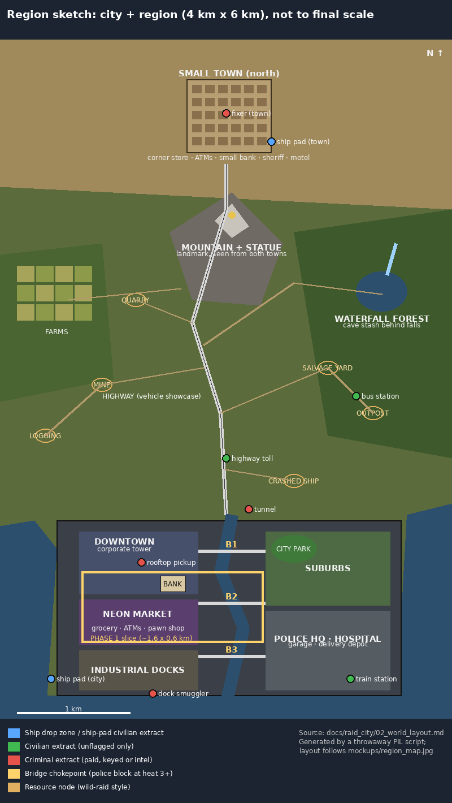
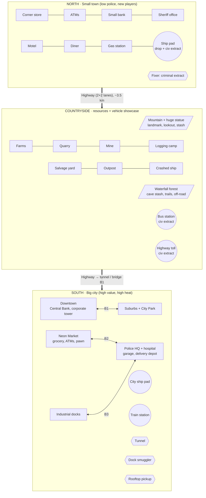

# 2. World layout: region, city, bridges, landmarks

[Index](../raid_city_design.md) · prev: [1. Rules](01_rules_and_loop.md) · next: [3. Vehicles](03_vehicles.md)

References: `mockups/region_map.jpg`, `mockups/city_topdown.jpg`, `mockups/downtown_aerial.jpg`, `mockups/street_view.jpg`.
These are concept art; the numbers in this file take priority over them.

## 2.1 Region, GTA V style

One region contains a **big city in the south** (the Los Santos role) and a **smaller, rougher town in the north**
(the Sandy Shores / Paleto Bay role). Between them are countryside, the mountain with the statue, the waterfall forest and a highway.

- **Small town:** easy early jobs (corner store, ATMs, a small bank) and low police (sheriff only, max effective heat 3 until backup arrives from the city after 4 min). It suits new players.
- **Big city:** the downtown Central Bank, the corporate tower, high heat, and the park.
- **The drive between them is the vehicle showcase:** highway curves around the mountain, dirt side roads to resource sites, off-road trails through the waterfall forest.
- **Reuse wild raid zones** as region POIs. The existing campus-style sites (`raid/scripts/glasskiln_campus.gd`, `raid/scripts/research_annex.gd`, `raid/scripts/obsidian_archive.gd`) and the Relay/Cinder landmarks (`raid/scripts/relay_landmark.gd`, `raid/scripts/cinder_landmarks.gd`) become the outpost, crashed ship and salvage yard sites. They give materials, just like today.

## 2.2 Map scale (checked against vehicle speeds)

The early guess was 2–4 km. That fits the **city alone**. City **plus region** needs more room.

| Item | Proposal | Why |
|---|---|---|
| Whole region | **4 km × 6 km** (24 km²), north up | Room for a ~3.5 km highway drive between the towns |
| Big city | ~3.0 × 1.6 km incl. river | 5 districts, 3 bridges |
| Small town | ~0.75 × 0.65 km | 15–25 buildings |
| Phase 1 district | **~0.6 × 0.5 km core** plus a ~1.6 km wide river crossing strip (Neon Market + bank block + bridge B2) | About 4–6× the area of Relay Ridge's 292 m play square (`PLAY_HALF := 146.0`, `raid/scripts/relay_config.gd`) |
| Settlement | **unchanged** | Home base stays its current size |

Speed check (metres per second; player on foot today is 4.2 walk / 7.0 sprint in `scripts/player.gd`):

| Mover | Cruise / top | Town → city (≈3.5–4 km road) | Notes |
|---|---|---|---|
| On foot (sprint) | 7 | ~9 min | Walking the region is not the plan |
| Scooter | 18 / 22 | ~3 min | Cheap, fragile |
| Sedan / SUV | 30 / 45 | **~90–120 s** | Matches GTA V's "a couple of minutes" between towns |
| Motorcycle | 35 / 55 | ~80 s | Fastest ground option |
| Hover car | 35 / 50 | ~90 s, ignores off-road slowdowns | Low altitude (≤ 3 m) |
| Flying car | 50 / 70 | **~60 s straight line** | That's why air lanes and anti-air exist (§3.4) |

Getaway distances: police lose you after **~30–45 s** without line of sight. At car speed that's 1–1.5 km, roughly one bridge plus one district.
Criminal extracts sit **600–1,200 m** from the bank. That's long enough for a chase, short enough that it doesn't drag.

Floating point: 6 km is inside the comfortable range for Godot's default single-precision build (~0.5 mm position steps at 4 km).
**No origin shifting and no double-precision engine build are needed** at this size. Re-check this if the region grows past ~8 km.

## 2.3 The big city (from `mockups/city_topdown.jpg`)

A river runs north–south with **3 bridges** (B1 north, B2 middle, B3 south). West bank: Downtown, Neon Market, Industrial Docks.
East bank: Suburbs + City Park, Police HQ + hospital + repair garage + delivery depot. Ship landing pad: outside the docks (drop zone).

| District | Content | Heat profile |
|---|---|---|
| Downtown | Central Bank (rung 5), corporate tower, glass towers, rooftop pads | Heavy patrols, anti-air near the bank |
| Neon Market | Grocery store, ATMs, pawn shop (fence), diner, arcade, gas station | Medium; best for early crime |
| Industrial docks | Warehouses, containers, truck depot, dock smuggler | Low security; criminal exits |
| Suburbs + City Park | Houses, corner store, taxi stand, park | Quiet; chases through the park |
| Police HQ / hospital | Police spawn, hospital (paramedic job), repair garage, delivery depot | Spawning area; avoid when flagged |

## 2.4 Bridges: chokepoints, police blocks, district links

Bridges are the main gameplay feature of the city layout:

- **Links:** the only road links between the banks. B1: Downtown ↔ Suburbs. B2: Neon Market ↔ Police HQ. B3: Docks ↔ depot.
- **Chokepoints:** at heat 3 the nearest bridge gets a police block (2 cars plus a spike strip, one lane open with a checkpoint).
  At heat 4 two bridges are blocked; at heat 5 all three. Flying cars, boats (later) and the sewer tunnel get around them.
- **Widths:** a main bridge is 4 lanes × 3.5 m plus 2 × 2.5 m walkways ≈ **19–20 m** clear. A narrow old bridge is 2 lanes + walkway ≈ **10 m**.
  See §3.5 for all road widths.
- **Under-bridge spaces:** piers and service walkways become stash spots and on-foot escape routes.
- **Art:** three distinct silhouettes help navigation: suspension (B1, seen in `downtown_aerial.jpg`), steel truss (B2), and a low concrete span (B3).

## 2.5 Landmarks (1–2 per region, seen from far away)

| Landmark | Where | Gameplay | LOD / impostor needs |
|---|---|---|---|
| **Huge statue on the mountain** | Mountain peak, between the towns | Stash at the base, sniper lookout, quest location, flying-car landing pad on the shoulder | LOD0 ≤ 60k tris near the base; LOD1 15k; LOD2 2k; **octahedral impostor** past 1.5 km; always visible; its own visibility range, not culled with terrain chunks |
| Central Bank dome / corporate tower | Downtown | Heist site, rooftop pickup | Tower impostor beyond 800 m; bank dome LOD2 ≤ 3k tris |

Artie owns the landmark art (see [6. Assets](06_assets.md)).

## 2.6 Other points of interest

- **City Park (Central Park style):** paths, a lake and ponds, small bridges, gazebos. Used for civilians, chases on foot and scooters, and stashes.
  Reuse the Settlement's lake and grass work (`shaders/inn_lake_v088.gdshader`, `raid/scripts/grass_view_culling.gd`).
  Foliage budget: see [5. Tech](05_tech_and_budgets.md) §5.5.
- **Waterfall forest:** a cave stash behind the falls, hiking trails, and an off-road route.
  Water and waterfall shader approach: a scrolling-UV ribbon mesh with a foam mask, plus GPU particles for mist (works in the Compatibility renderer) and a pool using the lake shader. No screen-space reflections (Compatibility has none).
- **Gas stations, farms, outposts and hidden stashes** along the highway. Each one is a small POI with a cache (`raid/assets/props/loot_cache_*`) or a job.

## 2.7 The Phase 1 slice

The yellow box in the sketch is the first build. **Neon Market** gives rungs 1–3, the **Central Bank block** on Downtown's
southern edge gives rung 5, and **bridge B2** gives the chokepoint. It also has 2 civilian extracts (ship pad, train station
via B2) and 2 criminal extracts (dock smuggler, sewer). The rest of the city is low-detail backdrop at first (impostor towers).
See [7. Build plan](07_build_plan.md).
