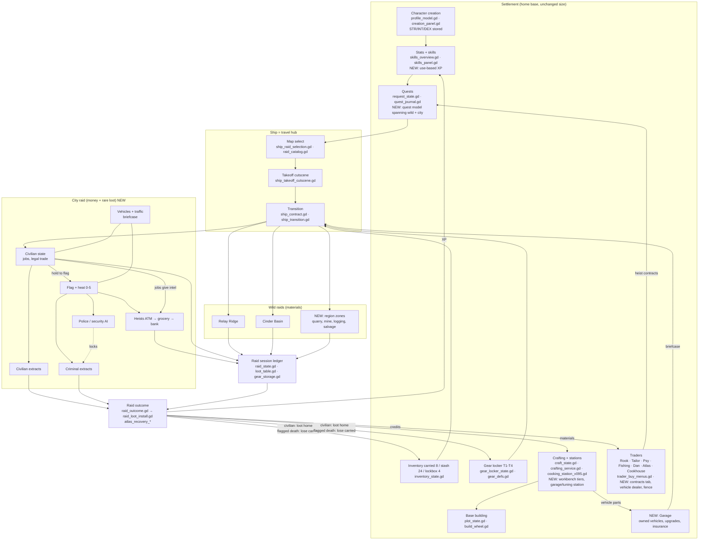

# 4. Systems: what the city plugs into, conflicts and gaps

[Index](../raid_city_design.md) · prev: [3. Vehicles](03_vehicles.md) · next: [5. Tech and budgets](05_tech_and_budgets.md)

All paths are relative to the repo root at main `f618de2`. "Pinned" means the file is listed in `tools/pinned-r8-runtime.json` (730 files).
Pinned files are changed through overrides in `raid/scripts`, as every PR has done so far.

## 4.1 One connected diagram

## 4.2 Existing systems the city plugs into (real files)

| System | Files today | What exists | What the city needs |
|---|---|---|---|
| **Ship and map select** | `scripts/launchpad_ship.gd`, `raid/scripts/ship_raid_selection.gd`, `raid/scripts/raid_catalog.gd`, `raid/scripts/ship_contract.gd`, `raid/scripts/ship_transition.gd`, `raid/scripts/ship_takeoff_cutscene.gd`, `raid/scripts/ship_boarding_wayfinding.gd` | Allowlisted raid ids (`relay_ridge`, `cinder_basin`); the Settlement is saved and freed before entry; cutscene, then the raid scene | New catalog entry (e.g. `nova_reach_neon_market`); briefcase vehicle in the transition binding; drop-zone choice (city pad / town pad) |
| **Raid world** | `raid/scripts/raid_world.gd` (710 lines), `relay_*.gd`, `cinder_*.gd`, `raid/scripts/raid_map.gd` | Shared lifecycle, extraction, readiness and map adapters; generated 384 m terrain in 32 m chunks | A city map adapter; typed extracts; streaming (see §5) |
| **Looting** | `raid/scripts/raid_state.gd`, `raid/scripts/raid_loot/loot_table.gd`, `raid_loot_service.gd`, `raid_loot_install.gd`, `raid_loot_store.gd` | Caches by quality 1–5; haul in pouch units (8 base); value; `apply_return` handles `extracted` / `downed` | Cash, stolen tag, heavy bags, vehicle cargo container, the new death rule |
| **Gear and stats in raid** | `raid/scripts/gear_tiers/*` (`gear_defs.gd`, `gear_locker_state.gd`, `raid_gear.gd`, `gear_storage.gd`), `raid/scripts/health_component.gd`, `raid/scripts/raid_health_controller.gd` | T1–T4 tiers, damage classes (ballistic, hazard, fall), weight bands, durability | Weapons, armor vs police fire, STR-driven carry |
| **Traders** | `raid/scripts/trader_buy_menus.gd` (Rook, Tailor, Psy, Fishing), `raid/scripts/gear_tiers/gear_shop_service.gd` (Psy tiers), `raid/scripts/dan_listings_*.gd` (Dan's player listings), `raid/scripts/atlas_recovery_*.gd` + `raid_loot/atlas_salvage_panel.gd` (Atlas recovery and salvage), `scripts/cooking_station_v095.gd` (Cookhouse) | Buy menus, credits, tier unlocks by extraction count (`raid_loot_store.gd` stats) | **Contracts tab** (heist jobs), a fence (pawn shop in the city, Atlas at home), vehicle dealer, insurance |
| **Quests** | `scripts/request_state.gd`, `scripts/request_panel.gd`, `scripts/quest_journal.gd`, `scripts/quest_journal_projection.gd`, `scripts/onboarding_state.gd` | One starter request (deliver 2 timber + 1 metal for 25 credits); a journal with filters; onboarding steps | A data-driven quest model with objectives across wild and city maps |
| **Skills** | `scripts/skills_overview.gd`, `scripts/skills_panel.gd` | Panel text only; "Tailoring and textile skill progression are not implemented" | Use-based XP: driving, lockpicking/hacking, stealth, shooting, strength, trading |
| **Character creation and stats** | `scripts/character_profiles/profile_model.gd` (`ATTRIBUTES = ["str","int","dex"]`), `scripts/character_preview/creation_panel.gd`, `scripts/character_profiles/experimental_rules.gd`, `scripts/character_profiles/title_session.gd` | STR/INT/DEX values are chosen and saved; **not applied** ("design concepts only" in `skills_overview.gd`) | Apply them: STR (carry weight, melee, drilling speed), DEX (lockpick, driving handling), INT (hacking, heat decay via disguise) |
| **Base and station building** | `scripts/plot_state.gd`, `scripts/build_wheel.gd` (13 kinds incl. workbench, lantern), `scripts/build_snap.gd`, `scripts/build_piece_materials.gd` | Free building in an 8×8 m plot (12×12 after the 100-credit expansion) | Garage / tuning station, upgraded workbench, cargo storage; costs in resources |
| **Crafting** | `scripts/craft_state.gd`, `scripts/crafting_service.gd`, `scripts/cooking_*.gd` | One job slot; only the `lantern` recipe (1–10 s); bench 2 timber + 1 metal | Recipe tables: gear, ammo, vehicle parts, station upgrades |
| **Resources and items** | `scripts/inventory_state.gd` (`ITEMS`, 11 ids; `CAPACITIES` carried 8 / stash 24 / lockbox 4), `raid/scripts/raid_loot/loot_table.gd` (`ITEMS`, `UNIT_WEIGHT`), `scripts/equipment_catalog.gd` (`SLOT_TYPES`) | Timber, stone, metal, cloth, thread, fish, bait, lantern kit; salvage (6–110 credits); composite insert | Fuel and oil, ore, food, fiber, electronics, medicine, chemicals, high-end parts, cash, intel |
| **Options / quality** | `scripts/options_panel.gd`, `raid/scripts/grass_view_culling.gd`, `scripts/scenery_optional_details.gd` | Grass, scenery and material-detail tiers | City tiers: traffic, pedestrian, draw distance, impostor distance |
| **Saves** | `scripts/save_codec.gd`, `scripts/character_profiles/profile_store.gd`, `raid_loot_store.gd` (atomic tmp+rename) | Per-character saves; sidecar stores per feature | Vehicle and garage store, heat history (none persisted), quest store |

## 4.3 Heist contracts from traders (proposed mapping)

| Trader | Today | City role |
|---|---|---|
| Atlas | Recovery and salvage | Fence for stolen goods at home; insurance clerk (holds lost vehicles like recovery) |
| Psy | Tiered gear, upgrades | Sells armor vs police; heist gear (drills, hack kits) T2–T4 |
| Rook | Supplies and materials | Buys region resources; sells vehicle raw parts |
| Dan | Outfit, listings | Disguises (heat decay), civilian outfits; listings for stolen-goods-free trade |
| Tailor | Clothing and dyes | Uniforms for security-guard / courier jobs |
| Fishing trader | Fishing supplies | Salvage diver job (later) |
| Cookhouse | Cooking | Street-vendor job recipes (later) |
| **New: Fixer** (board on the ship or at the inn) | — | Heist contracts (rungs 1–5), criminal extract deals |

## 4.4 Resource economy, mapped to current code

| Source | Resource | Exists today? | Where / gap |
|---|---|---|---|
| Region | Wood | Yes: `timber` | `inventory_state.gd` `ITEMS`, `loot_table.gd` |
| Region | Stone and ore | Partly: `stone`; **ore missing** | Add `ore_iron`, `ore_copper` |
| Region | Food and fiber | Partly: `river_fish`, `stream_fish`, `cloth_linen`, `thread_spool` | Add crops and fiber (farms) |
| Region | Fuel and oil | **No** | New; vehicles burn fuel (proposal: soft, refuel at gas stations) |
| Region | Scrap and tech | Yes: `metal` (scrap), `salvage_*` (6 kinds) | Salvage yards and crashed ships reuse the cache loop |
| City | Electronics | Close: `salvage_sensor`, `salvage_capacitor` | Add `electronics` as a processed good |
| City | Medicine | Raid-only: `field_dressing` (`loot_table.gd` `SUPPLIES`) | Add a persistent `medicine` item |
| City | Chemicals | **No** | New |
| City | High-end parts | Close: `composite_insert` (raid-only part) | Add `hi_parts` for T4 gear and vehicle upgrades |
| Both | Credits / cash | Credits exist (plot state, shops) | Add cash on hand (lost on a flagged death) vs banked credits |
| City | Intel | Partial: codes/keys/cards (`field_supplies.gd`, `raid_state.gd` `code_for`) | Intel items that carry over between runs |

**Station outputs:** gear (Psy upgrades already use metal, cloth and the insert), base and station upgrades (`build_wheel.gd` pieces with
costs), vehicle parts and ammo (new garage and workbench recipes).

**Vehicle cargo matters on runs:** a van carries 24 units against an 8-unit pouch, so resource runs need vehicles.
**Rich nodes draw players and NPC gangs:** nodes have a richness tier. High tiers spawn a gang patrol (reuses police AI with a gang faction).

## 4.5 Conflicts with the current code

| # | Conflict | Where | Proposed resolution |
|---|---|---|---|
| C1 | **Death rule.** Today a downed raid loses the whole haul ("Downed: nothing comes home") and carried stacks go to Atlas recovery (pay to get them back). **Equipped gear is kept** with 25% durability loss. The new rule wants civilians to keep *everything* and flagged players to lose *everything carried*, including equipped gear | `raid/scripts/raid_loot/raid_loot_install.gd` (`apply_return`), `raid/scripts/atlas_recovery_service.gd`, `raid/scripts/gear_tiers/gear_defs.gd` (`DOWNED_DURABILITY_LOSS`), `raid/scripts/gear_tiers/raid_gear.gd` | Add `flagged: bool` to the outcome. Civilian `downed` acts like `extracted` (minus wear); flagged `downed` loses the haul, carried items and equipped gear. Atlas recovery becomes the **insurance** path. **Decide whether wild raids also use flag rules** (Q1) |
| C2 | Outcome kinds are only `extracted` / `downed` | `raid_loot_install.gd`, `raid/scripts/raid_outcome.gd` | Add `arrested` and an `extract_type` (civilian/criminal) |
| C3 | Extraction is one radius (4 m) and an 8 s hold for everyone | `raid/scripts/raid_world.gd` (`EXTRACTION_RADIUS`), `raid/scripts/raid_state.gd` (`EXTRACTION_DURATION`, `start_extraction`) | Typed extracts with conditions (flag, key, fee, heat lock) behind the existing map-adapter hooks |
| C4 | The raid ledger "never reads/writes settlement inventory", and the haul is pouch units only | `raid_state.gd`, `loot_table.gd` (`HAUL_BASE_CAPACITY := 8`) | Add vehicle cargo as a second raid container; the briefcase is a haul item with its own store |
| C5 | Two item registries, both closed allowlists with strict validation. Every new resource needs both changed plus a save-version bump | `scripts/inventory_state.gd` (`ITEMS`, `restore`), `raid/scripts/raid_loot/loot_table.gd` (`ITEMS`) | One shared item catalog file; versioned migration in the saves |
| C6 | Stats are saved but not applied | `profile_model.gd` (`ATTRIBUTES`), `skills_overview.gd` ("No attribute values, bonuses or unlocks are applied") | Activate a small, clear set of stat effects (carry, melee, drill, lockpick, heat) |
| C7 | No skill progression exists | `skills_overview.gd`, `skills_panel.gd` | New skills store with use-based XP |
| C8 | Quests are one hard-coded starter request | `request_state.gd` (`REQUIRED`, `REWARD`), `quest_journal_projection.gd` | Data-driven quest model; the journal projects many quests |
| C9 | Crafting supports one recipe (`lantern`) and one job | `craft_state.gd` (`restore` rejects other recipes), `crafting_service.gd` | Recipe table and queue; keep the strict-restore style |
| C10 | **No player weapons or combat**: the slots exist (`primary_firearm`, `sidearm`, `melee_tool`) but no definitions; the only hostile is a hitscan turret | `scripts/equipment_catalog.gd` (`SLOT_TYPES`), `raid/scripts/sentry_turret.gd` | Weapons, ammo, melee, NPC combat. This is a prerequisite for flagging and must be designed first |
| C11 | Economy scale: 150 starting credits, a 100-credit plot expansion, salvage worth 6–110 credits, a T1 helmet at 24 | `scripts/settlement.gd`, `loot_table.gd`, `gear_defs.gd` | City payouts (up to 6,000) need sinks: vehicles, upgrades, insurance, fixer fees, higher-tier stations |
| C12 | **No NPC AI or character animation**: the player has no AnimationPlayer/AnimationTree; staff NPCs are static fitted models; wildlife is decorative | `scripts/player.gd`, `scripts/hall_staff_coverage.gd`, `scripts/staff_fit.gd`, `scripts/ambient_wildlife.gd` | Locomotion animation set plus navigation (NavigationServer3D) for civilians, police and gangs. A big new system |
| C13 | No vehicles and no roads | `scripts/player.gd`; TASKS item 20 | §3 build order |
| C14 | Renderer is `gl_compatibility` (`project.godot`): no SSR, no volumetric fog, no SDFGI. The mockups' wet neon reflections must be faked | `project.godot` | Reflection probes plus a roughness/puddle-mask trick and emissive signs; see §5 |
| C15 | Terrain is generated per map as trimesh chunks; fine at 384 m, too heavy for 24 km² | `raid/scripts/relay_generator.gd` (`create_trimesh_shape()` per chunk) | Heightmap terrain with `HeightMapShape3D` collision, or Terrain3D (§5.1) |
| C16 | Pinned-file and import policy: adding a GDExtension (Terrain3D) means native binaries, import approvals (`vendor/approved-runtime-imports`) and manifest updates (`SOURCE-MANIFEST.json`, `PUBLIC-TOOLS-SHA256.json`) | `tools/pinned-r8-runtime.json`, `vendor/` | Decide in the Phase 0 tech spike |
| C17 | Tests hard-code the two raid ids | `raid/tests/test_ship_takeoff_cutscene.gd` (lines 97–100), `raid/tests/test_raid_audio.gd` (line 65) | Update when the city id is added |
| C18 | Everything is single-player and local (Dan's listings are local; saves are local files) | `raid/scripts/dan_listings_service.gd`, `scripts/save_codec.gd` | See §4.6 |

## 4.6 Gaps (no code today)

Weapons and combat, NPC AI and animation, police and wanted system, vehicles and traffic, roads, streaming and large terrain, city art,
a cash economy and sinks, quests, skills, garage, networking.

## 4.7 Later: parties and clans

- **Parties:** squad up on the ship, drop in together, shared or per-player loot split (proposal: each player keeps what they carry;
  heist payouts split evenly at the extract), **party flagging** (when one member flags, the whole party is flagged after a 5 s warning).
- **Clans:** persistent groups, a shared base or stations (a clan plot next to the Settlement), clan heists (rung 5+ with 4+ players).
- **Networking needed:** authoritative server per raid instance (Godot high-level multiplayer with ENet, or a dedicated headless server build),
  plus a backend for accounts, clan data and a server-side economy. Godot headless runs are already in use for tests.
- **Impact on single-player code:** today's state services are "pure candidate builders" that never write files
  (`atlas_recovery_service.gd`, `dan_listings_service.gd`, `raid_state.gd`). That pattern ports well to server authority.
  Direct node mutation in `scripts/settlement.gd` doesn't.
- **Design for now (cheap insurance):**
  - Put flag, heat, haul and vehicle state in plain data objects, not nodes.
  - Seed all procedural spawns (`raid_state.gd` already takes a seed).
  - Keep IDs stable and string-based.
  - Route every reward through one outcome function (`raid_loot_install.apply_return`).
  - Never let the UI write state directly.
